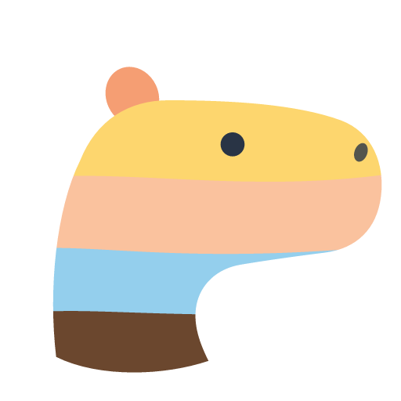
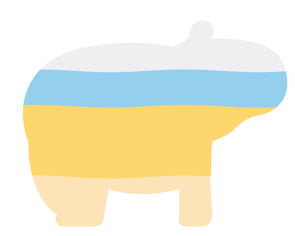
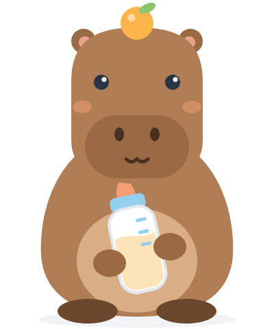

# MilkBaby brand

A capybara instead of Waterllama's llama. The SVGs here are the master artwork. The SwiftUI views in
`MilkBaby/Mascot` draw the same shapes: they use the same path data (`d` attributes) via `SVGPath`,
so if you change a shape here, paste the new `d` string into the matching Swift file.

| Asset | Master | SwiftUI | Used for |
|---|---|---|---|
| Logo / mark | `logo.svg` | `CapybaraLogo` | Splash, app icon |
| App icon | `app-icon.svg` | — (`AppIcon.png`, 1024², no alpha) | Home screen |
| Silhouette | `capybara-silhouette.svg` | `CapybaraSilhouette`, `MascotFillView` | Home fill meter |
| Illustration | `capybara-illustration.svg` | `CapybaraIllustration` | Onboarding welcome |

  

## The mark

A side-profile capybara head built from stacked milk-colour bands, the same idea as Waterllama's
layered llama head. From the top down:

| Band | Colour | Theme |
|---|---|---|
| Ear | `#F59E73` | `Theme.accent` |
| Crown | `#FDD66E` | `Theme.milkButter` |
| Snout | `#FAC29E` | `Theme.milkPeach` |
| Jaw | `#94CFED` | `Theme.milkSky` |
| Neck | `#6B472E` | `Theme.capybaraDark` |
| Eye, nostril | `#293445` | `Theme.ink` |

App icon background: warm cream `#FFF6E6` (`CapybaraLogo.iconBackground`). The icon is full-bleed
and square because iOS applies the corner mask.

## Fill meter

`MascotFillView` maps 0–100% onto the silhouette's real height (`CapybaraSilhouette.verticalExtent`,
from ear tip to soles), not onto the whole frame, so small amounts show up straight away. Bands stack
in the order given by `segments`, spring to new heights, and ripple slowly. The ripple stops when
Reduce Motion is on.

## Rendering

Render with any SVG renderer that supports clip paths. The PNGs here were made with
[resvg](https://github.com/RazrFalcon/resvg) (`@resvg/resvg-js`), because cairosvg needs the system
`libcairo`, which this machine doesn't have:

```sh
npm install @resvg/resvg-js@2.6.2
node -e "const {Resvg}=require('@resvg/resvg-js');const fs=require('fs');
fs.writeFileSync('AppIcon.png', new Resvg(fs.readFileSync('app-icon.svg'),{fitTo:{mode:'width',value:1024}}).render().asPng())"
```

The App Store rejects icons with an alpha channel, so flatten the PNG to RGB before you commit it.
